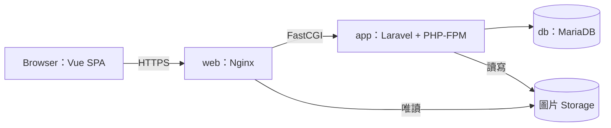

# Home Fitness｜Laravel + Vue 電商作品集

Home Fitness 是家用重訓器材電商作品集，使用 **Vue 3 + TypeScript** 與 **Laravel 13**，已部署至 AWS Lightsail。前台提供商品瀏覽、會員、購物車與結帳；後台管理商品、庫存、訂單與內容，並開放免帳密的唯讀 Demo。

核心設計涵蓋**結帳與庫存一致性、後台權限、購物車登入合併，以及非同步請求與錯誤處理**。

[核心技術亮點](#核心技術亮點) · [測試與驗證](#測試與驗證) · [本機執行方式](#本機執行方式) · [正式部署](#正式部署)

## 線上展示

| 入口 | 體驗方式 |
| --- | --- |
| [正式網站](https://homefit-store.ddnsfree.com) | 可直接瀏覽商品、使用訪客購物車；體驗會員與結帳功能，請先自行註冊測試帳號，再登入操作 |
| [唯讀後台](https://homefit-store.ddnsfree.com/admin/login) | 點選「進入唯讀 Demo」，不需管理員帳密 |
| [原始碼](https://github.com/don30362-stack/home-fitness-laravel-store) | 查看功能實作、測試與部署設定 |

後台 Demo 可瀏覽 Dashboard、商品、分類、庫存與首頁內容；不能新增、修改或刪除，也不開放會員、訂單與管理員管理。

**網站僅供作品展示。** 結帳會在系統內建立訂單並扣除庫存；付款選項為貨到付款與模擬信用卡，未串接第三方金流，模擬付款不會實際扣款。請使用測試資料，不要輸入真實個資或信用卡資訊。

## 核心技術亮點

### 1. 結帳與庫存一致性

後端在結帳時重新計價並檢查庫存，將建立訂單、扣庫存與清空購物車放在同一個**資料庫交易**中，任一步失敗就全部回復。**列鎖**用來協調同時操作相同資料的請求。

訂單保存商品名稱、規格與價格快照，避免後續商品異動影響既有訂單。取消時先鎖定訂單、確認狀態，再回補原庫存位置，避免重複取消造成重複回補。

[結帳 Service](backend/app/Services/CheckoutService.php) · [取消 Service](backend/app/Services/OrderCancellationService.php) · [結帳測試](backend/tests/Feature/CheckoutApiTest.php) · [取消測試](backend/tests/Feature/OrderCancellationApiTest.php)

### 2. 後台權限與唯讀 Demo

會員與管理員使用不同的認證 Guard 和前端狀態。後台由 Middleware 檢查七項模組權限；會員 API 則依登入者查詢購物車、地址與訂單，避免存取其他會員資料。前端導覽與路由限制僅輔助操作，實際授權由後端執行。

Demo 使用獨立身分，**Demo 僅允許八個指定的 GET API（包含身分查詢）**，另保留進入 Demo 與登出的 POST。限制不受額外模組權限影響，也可透過設定停用；Demo 登出後，會員仍保持登入。

[認證設定](backend/config/auth.php) · [權限 Middleware](backend/app/Http/Middleware/EnsureAdminHasPermission.php) · [Demo 白名單](backend/app/Services/AdminDemoService.php) · [Demo 存取限制](backend/app/Http/Middleware/EnsureAdminDemoAccess.php) · [Demo 測試](backend/tests/Feature/AdminDemoApiTest.php)

### 3. 購物車儲存與登入合併

訪客購物車存在 localStorage，會員購物車存在資料庫，登入後透過 API 合併。**相同商品與規格取兩邊較大的數量，不相加**；不同規格分開保留。合併數量不能超過可用庫存，超過時拒絕合併，並回復整筆交易。

前端確認合併成功、登入狀態仍有效後，才清除訪客資料；失敗時保留原內容與重試入口。測試涵蓋合併規則、資料所有權、庫存限制與失敗回復。

[Pinia 購物車](frontend/src/stores/cart.ts) · [CartController](backend/app/Http/Controllers/Api/CartController.php) · [API 測試](backend/tests/Feature/CartApiTest.php) · [Session／Cart 回歸](frontend/scripts/c06.test.mjs)

### 4. 非同步請求與錯誤處理

快速切換搜尋條件，或登出後重新登入時，舊請求可能較晚回來。前端以登入狀態版本與請求序號判斷回應是否仍有效，避免舊資料覆蓋畫面；離開頁面後也不再套用結果。

若地址修改成功，但清單重新載入失敗，畫面會保留成功訊息、提醒清單可能過時，並暫停異動、提供重新讀取。這能避免把修改誤報為失敗，或自動重送已成功的操作。

[登入狀態版本](frontend/src/services/sessionState.ts) · [後台請求處理](frontend/src/services/adminApi.ts) · [商品列表](frontend/src/views/ProductListView.vue) · [地址頁](frontend/src/views/MemberAddressView.vue) · [錯誤處理測試](frontend/scripts/frontend-resilience.test.mjs)

### 5. 共用元件與使用體驗

商品卡片、分頁、確認視窗與提示訊息使用共用 Vue 元件，讓不同頁面的操作一致。確認視窗支援初始焦點、Tab 焦點限制、Esc 取消與關閉後焦點返回；重要錯誤不會自動消失。

前端送出請求後顯示處理狀態，避免重複點擊。這與後端以交易、列鎖維持資料一致性的責任不同。另以真實瀏覽器檢查代表頁面的 RWD 與鍵盤操作。

[ProductCard](frontend/src/components/product/ProductCard.vue) · [AppConfirmDialog](frontend/src/components/common/AppConfirmDialog.vue) · [AppNotice](frontend/src/components/common/AppNotice.vue) · [前台 UI 測試](frontend/scripts/storefront-ui.test.mjs) · [後台回歸](frontend/scripts/admin-auth.test.mjs)

## 主要功能

| 區域 | 已完成內容 |
| --- | --- |
| 商品 | 首頁 Banner／推薦、分類、搜尋、價格篩選與排序、分頁、圖片畫廊、規格與相關商品 |
| 會員 | 註冊／登入／登出、資料與密碼修改、地址簿與預設地址、訂單查詢與取消 |
| 購物流程 | 訪客與會員購物車、登入合併、地址帶入、結帳、貨到付款與模擬信用卡、訂單快照 |
| 管理後台 | Dashboard、商品／圖片／規格、分類、庫存、訂單與手動物流資訊管理、會員、Banner／推薦商品、管理員與七項模組權限 |
| 使用體驗 | About／FAQ、RWD、表單與操作回饋、一鍵唯讀 Demo |

## 技術組合

| 層級 | 技術與用途 |
| --- | --- |
| 前端 | Vue 3、TypeScript、Composition API；Pinia 管理身分與購物車，Vue Router 管理頁面與查詢條件，Axios 處理 API 請求 |
| 介面與建置 | Bootstrap 5、HTML／CSS、Vite；實作 RWD、共用元件與靜態資產建置 |
| 後端 | PHP 8.4、Laravel 13、Sanctum SPA；Session 維持登入狀態，CSRF token 防範跨站請求偽造，提供 REST API，並使用 API Resource 統一 JSON 回應格式 |
| 資料庫 | 正式使用 MariaDB 11.4；以交易與列鎖處理庫存一致性 |
| 測試 | PHPUnit 12、Node.js test runner；涵蓋 API、狀態管理、請求與 Vue 元件，另做瀏覽器驗證 |
| 部署 | Docker Compose、Nginx、GitHub Actions、GHCR、AWS Lightsail |

## 作品畫面

**商品規格與購買介面｜正式網站**


<details>
<summary>查看首頁、商品列表、手機購物車、訂單與唯讀後台</summary>

**首頁品牌與商品展示｜正式網站**


**商品搜尋與分類｜正式網站**


**手機購物車｜正式網站｜測試購物車**


**訂單詳細｜正式網站｜測試帳號與測試訂單**

畫面使用可公開的測試資料，不代表真實商業交易。


**唯讀後台商品管理｜正式公開 Demo**


</details>

## 系統架構



正式前後端共用網域，API 路徑為 `/api`。Nginx 提供前端與圖片，並將 API 請求交給 Laravel。Node 只用於前端建置，正式環境不需常駐 Node 服務。

Laravel 的 Middleware 與 Request 負責認證、授權及輸入驗證；Controller、Service 與 Eloquent 負責業務流程及資料存取。依賴版本以 [composer.lock](backend/composer.lock) 與 [package-lock.json](frontend/package-lock.json) 為準。

## 測試與驗證

驗證包含本機回歸、隔離 MariaDB 整合與正式站檢查。以下依執行日期、版本與環境分列；**本機測試候選版的測試不等於正式部署後重跑**，數字也不能直接相加。本次僅整理文件，未重新執行功能測試。

| 日期與版本 | 環境／結果 | 範圍與限制 |
| --- | --- | --- |
| 2026-10-23，安全更新本機測試候選版（提交前） | 本機前端 **909 PASS**；Laravel **1,063 PASS／2 SKIPPED** | 前端為 Node.js 回歸，不是 Browser E2E；後端使用 SQLite `:memory:`，兩項因 symlink 環境限制跳過 |
| 2026-10-23，加入基底映像更新的本機測試候選版（提交前） | 隔離 Linux／MariaDB：**32 組、116 筆 HTTP 通過**；真實瀏覽器 **9 項通過** | 使用合成資料驗證功能、結帳、庫存與失敗回復；不是正式站交易驗收，也未重跑前列單元測試 |
| 2026-10-23，正式 `86dfcde7` | **38 項 HTTP 符合預期**，73 個靜態檔雜湊一致，3 張商品圖片正常 | 正式站唯讀檢查；本輪未重測結帳、付款、取消與庫存異動 |
| 2026-10-23，正式 `86dfcde7` | 會員／Owner 管理員 **三類人工驗收通過**，由使用者確認 | 會員登入／登出；地址簿、購物車與既有訂單唯讀；Owner 登入、權限與唯讀功能 |

<details>
<summary>歷史驗證、版本關係與測試入口</summary>

10 月 23 日兩次候選驗證以 `5211ec50` 為基準，先更新套件，再更新前端建置與 Nginx 基底映像，完成後提交為 `86dfcde7`。候選測試結果依各次執行範圍記錄，未宣稱全部都在該提交上重新執行。

- **並行交易：** 2026-10-11，MariaDB 11.4.13 的 12 個競爭場景通過，涵蓋結帳、庫存調整與取消。使用雙程序、獨立連線與實際鎖等待；當時精確 SHA 尚未補齊，不是目前版本重測或全面壓測。
- **後台授權：** 2026-10-13，`b882b81` 的 Admin／Demo 專項測試為 128 PASS／1,514 assertions；屬專項子集，已納入後續版本。
- **RWD：** 2026-10-13，三批 UI 提交與 `3ff0e39` 的代表頁面驗收涵蓋 320／390／768／1280 寬度；整合驗收只重驗部分情境，不是全站四尺寸 E2E。

原始驗收紀錄與截圖保存在本機，未放入公開 Repository。可從以下測試查看案例：

- 交易與資料保護：[結帳](backend/tests/Feature/CheckoutApiTest.php)、[取消](backend/tests/Feature/OrderCancellationApiTest.php)、[訂單所有權](backend/tests/Feature/OrderApiTest.php)。
- 認證與授權：[Demo](backend/tests/Feature/AdminDemoApiTest.php)、[模組權限](backend/tests/Feature/AdminPermissionAuthTest.php)、[訪客 JSON／HTML 401](backend/tests/Feature/GuestApiAuthenticationTest.php)。
- 前端互動：[錯誤處理](frontend/scripts/frontend-resilience.test.mjs)、[後台](frontend/scripts/admin-auth.test.mjs)、[Session／Cart](frontend/scripts/c06.test.mjs)、[訂單／結帳](frontend/scripts/order-list.test.mjs)。

</details>

<details>
<summary>測試與 Build 指令</summary>

[phpunit.xml](backend/phpunit.xml) 使用 testing 環境與 SQLite `:memory:`，Session 與 Cache 也存在記憶體中。執行前，請確認環境變數與既有設定快取未指向日常或正式資料庫。

```bash
cd backend
php artisan test
```

前端八組可依序執行，避免多個 Vite 測試程序並行競爭快取：

```bash
cd frontend
npm run test:admin
node --test scripts/frontend-resilience.test.mjs
node --test scripts/storefront-ui.test.mjs
node --test scripts/auth-rate-limit.test.mjs
npm run test:c06
npm run test:home
npm run test:content
npm run test:orders
npm run build
```

`npm run build` 已包含 type-check；單獨檢查型別可用 `npm run type-check`。GitHub Actions 目前執行 Image build／publish，未接入上述完整回歸矩陣。

</details>

## 本機執行方式

可選擇原生開發或本機 Docker。以下流程尚未以全新 Clone 完整驗證；請使用自己的開發資料庫與設定，不要沿用正式密碼或 Volume。

<details>
<summary>原生 Laravel＋Vite 開發</summary>

需要 PHP `^8.3`、Composer 2，以及 Node.js `^22.18.0` 或 `>=24.12.0`。資料庫以已驗證的 MariaDB 11.4 為準，Oracle MySQL 未單獨驗證。PHP 擴充套件需符合 Laravel 與 Composer 要求，包含連線資料庫的 `pdo_mysql`、執行 SQLite 測試的 `pdo_sqlite`。正式 Docker 使用 PHP 8.4。

```bash
git clone https://github.com/don30362-stack/home-fitness-laravel-store.git
cd home-fitness-laravel-store/backend
cp .env.example .env
composer install
```

先建立**全新、專用的開發資料庫**，設定 `backend/.env` 的 DB 連線與自用密碼；保留 `APP_ENV=local`，並加入：

```dotenv
APP_URL=http://127.0.0.1:8000
SANCTUM_STATEFUL_DOMAINS=127.0.0.1:5173
SESSION_DOMAIN=null
SESSION_SECURE_COOKIE=false
```

確認目標無既有需保留資料，再逐步執行：

```bash
php artisan key:generate
php artisan migrate --seed
php artisan storage:link
php artisan serve --host=127.0.0.1
```

另一個終端於 `frontend/`：

```bash
npm ci
cp .env.example .env
npm run dev
```

開啟 `http://127.0.0.1:5173`，API 為 `http://127.0.0.1:8000/api`，與前端 `.env.example` 一致。Windows PowerShell 可用 `Copy-Item .env.example .env` 取代 `cp`。

- 開發網址統一使用 `127.0.0.1`，不要與 `localhost` 混用。CORS 需允許前端來源，Sanctum 需將前端列為 stateful domain；Axios 則要攜帶 Cookie 與 CSRF token。[開發 CORS](backend/config/cors.php) · [Sanctum](backend/config/sanctum.php) · [Axios](frontend/src/services/api.ts)
- Seeder 建立地區、權限及商品開發資料，**不會產生實際商品圖片或重現完整正式 Showcase**；圖片 Factory 只產生路徑。素材準備仍需另行完成，勿使用正式會員／訂單資料。
- Seeder 不建立可共用的管理員帳密。原生 local/testing 環境可執行 `php artisan admin:bootstrap`，互動輸入自己的帳密建立開發管理員；不適用正式環境。
- 本機 Demo 需另執行 `admin:provision-demo`，依輸出 ID 設定 `ADMIN_DEMO_ID` 與 `ADMIN_DEMO_ENABLED=true`；不要將正式 Demo ID 當成本機固定值。
- `migrate --seed` 不是可對既有資料庫隨意重跑的復原程序。

</details>

<details>
<summary>本機 Docker Compose</summary>

[compose.yaml](compose.yaml) 已有本機運行紀錄，包含 app、web 與 MariaDB。web 使用 `127.0.0.1:8081`，資料庫不對外開放連接埠。此方式執行建置後的網站，不提供 Vite 即時更新。

1. 確認使用本機 Docker Linux Engine，8081 未被占用，且 `hfs-portfolio-local` project／Volumes 未存在；若已有其他本機環境，先確認邊界，不停止或刪除它。
2. 在 Git Repository 外建立自己的 `../homefit-local.env`，限制存取，提供全新 `APP_KEY`、`HFS_DB_NAME`、`HFS_DB_USER`、`HFS_DB_PASSWORD`、`HFS_DB_ROOT_PASSWORD`。不複製正式 Runtime 檔；不將此檔加入 Git。
3. 在專案根目錄逐步執行：

```bash
docker compose -p hfs-portfolio-local --env-file ../homefit-local.env -f compose.yaml config --quiet
docker compose -p hfs-portfolio-local --env-file ../homefit-local.env -f compose.yaml build
docker compose -p hfs-portfolio-local --env-file ../homefit-local.env -f compose.yaml up -d
```

確認 DB healthy 且為上述全新專用資料庫後，才執行初始化：

```bash
docker compose -p hfs-portfolio-local --env-file ../homefit-local.env -f compose.yaml exec -T --user www-data app php artisan migrate --seed --force
```

此處 `--force` 僅因 Compose 設定 `APP_ENV=production`；不代表允許操作既有或正式 DB。圖片與展示資料限制同上。瀏覽 `http://127.0.0.1:8081`，使用 `docker compose ... ps` 核對健康狀態；不以 `down -v` 或 prune 處理啟動問題。

</details>

## 正式部署

Docker Compose 分開執行 app、web、db。GitHub Actions 由**手動觸發**建置映像並發布至 GHCR；AWS Lightsail 依部署手冊更新，並非 CI 自動部署。

更新前核對 Git SHA、映像 Digest 與平台，確保前後端使用同一版本。更新 app 後重建設定快取、重啟 PHP-FPM，讓 OPcache 載入新版程式。資料庫、圖片與敏感設定獨立保存，更新映像時保留。

部署、更新、回滾與備份操作見[部署手冊](deploy/production/README.md)；其中環境狀態標有紀錄日期，不能當作即時狀態。

<details>
<summary>發布與備份驗證紀錄</summary>

2026-10-23 正式部署來源為 [`86dfcde7`](https://github.com/don30362-stack/home-fitness-laravel-store/commit/86dfcde7f86e72ee98a2aa346300971932529815)，app／web 均重新建置並使用同一 SHA 標籤。安全更新經 [Merge Commit `6b53544`](https://github.com/don30362-stack/home-fitness-laravel-store/commit/6b53544b559341ea336f8faeb794c4c9edf13845) 納入 `main`；後續合併或文件提交不代表正式站已更新，部署來源仍以 AWS `RELEASE_SHA` 為準。

該次更新先停止業務寫入、等待交易排空，建立加密異地一致備份。在隔離環境通過 27 表、19 個外鍵、115 個 Storage 檔案的實際還原後，再更新 app／web，保留原 MariaDB、全部 Volumes、舊映像與回滾材料。這是資料與檔案還原驗證，尚非整站災難復原演練。

發布紀錄：[2026-10-23 雙映像安全更新](https://github.com/don30362-stack/home-fitness-laravel-store/actions/runs/39924460985) · [2026-10-22 PHP 修補](https://github.com/don30362-stack/home-fitness-laravel-store/actions/runs/39718470768) · [2026-10-13 歷史 CI](https://github.com/don30362-stack/home-fitness-laravel-store/actions/runs/38362185865)。

</details>

設定入口：[正式 Compose](compose.production.yaml) · [Backend Dockerfile](backend/Dockerfile) · [Frontend Dockerfile](frontend/Dockerfile) · [建置發布 Workflow](.github/workflows/docker-publish.yml) · [HTTPS 設定](deploy/production/nginx/https.conf)。

## 專案限制

- **金流與物流：** 未串接第三方金流／物流，物流由後台人工管理。未實作正式退款、退貨或換貨；取消模擬已付款訂單不等於退款。
- **功能範圍：** 授權採七項模組與獨立唯讀 Demo，未實作完整角色權限系統（roles／RBAC）、收藏、公告或 brands。
- **驗證範圍：** 交易、列鎖與防重複提交有對應測試，但不保證所有重送情況都只處理一次。尚未完成全面資安與高負載驗證；RWD 與鍵盤檢查也不等於完整 WCAG 認證。
- **部署與復原：** 正式為單機 Lightsail，未承諾零停機或高可用，也不是 AWS 全自動部署。已有加密異地備份與隔離 SQL／檔案還原驗證，**尚未完成正式網站端到端災難復原演練**。
- **已知依賴風險：** 2026-10-23 候選掃描的 Composer audit 為 0 則、`npm audit --omit=dev` 為 0 個漏洞節點；完整 `npm audit` 仍有同一條 braces 開發工具依賴鏈的 **4 個 High 節點**。未以 ignore 或強制降版隱藏；該鏈不作為 Node 服務部署至正式 Nginx。這是當次掃描結果，不代表整站沒有其他漏洞。
- **AI 協作：** 使用 AI／Codex 輔助實作、測試、除錯、文件與重構，搭配需求規劃、功能取捨及階段驗收完成部署；部分程式由 AI 協作完成，並非全部獨立手寫。
- **公開資料：** 正式帳密、Runtime Secrets、私鑰、SQL 備份及會員／訂單個資不屬公開作品集素材。

## 主要程式碼

- 後端：[API 路由](backend/routes/api.php)、[Requests](backend/app/Http/Requests)、[Services](backend/app/Services)、[Resources](backend/app/Http/Resources)。
- 前端：[路由](frontend/src/router/index.ts)、[後台路由](frontend/src/router/adminRoutes.ts)、[Stores](frontend/src/stores)、[Services](frontend/src/services)、[共用元件](frontend/src/components/common)。
