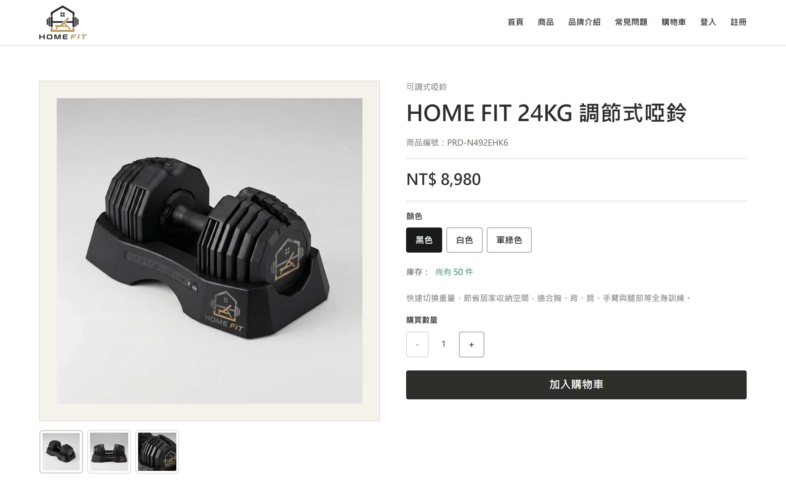
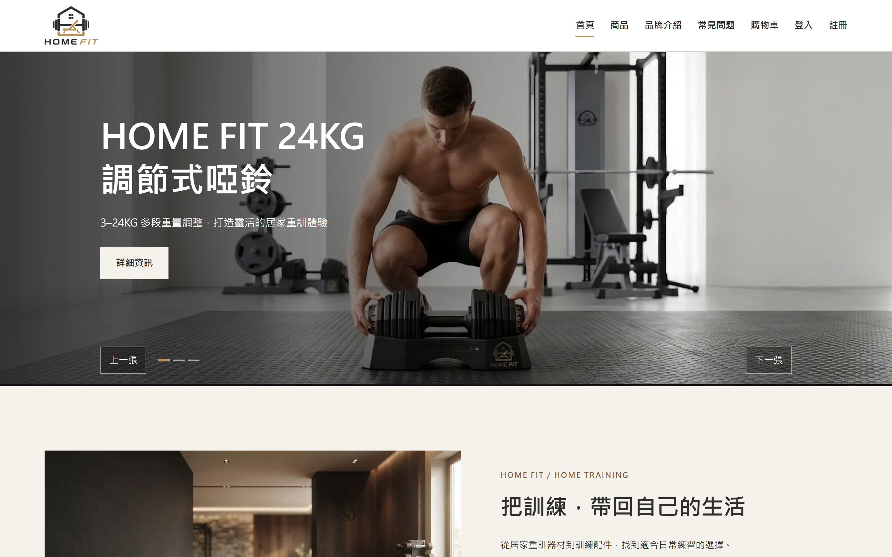
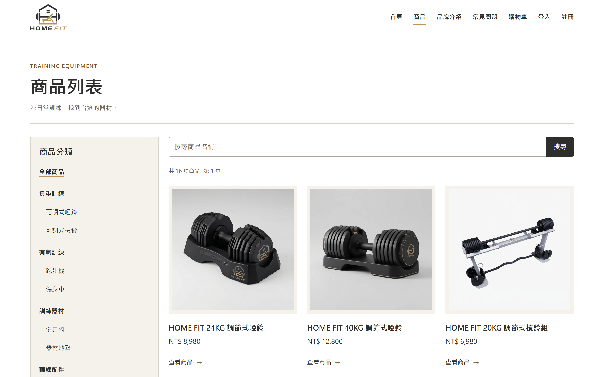
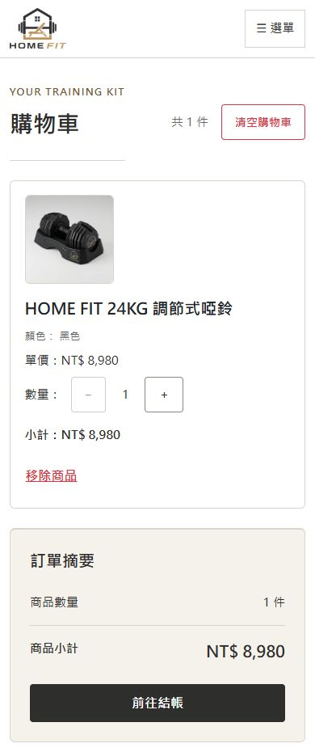
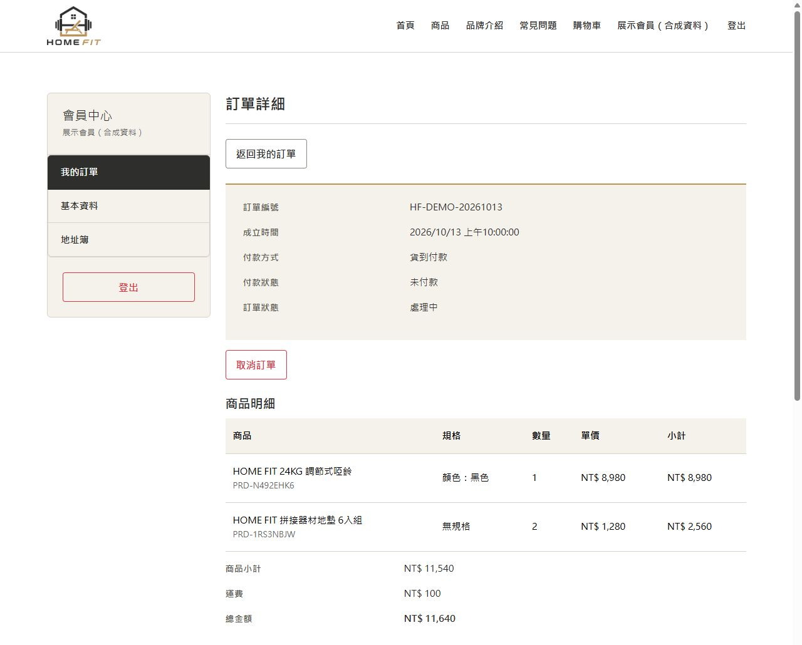
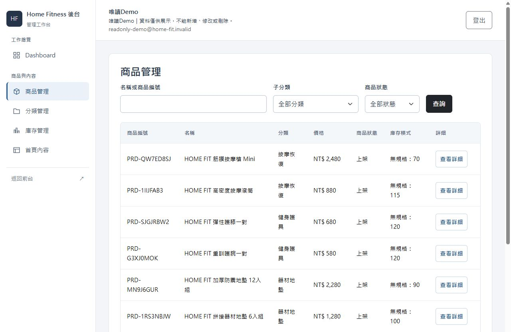
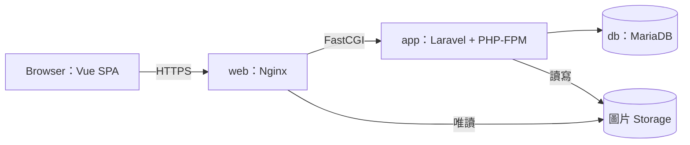

# Home Fitness｜Laravel + Vue 電商作品集

Home Fitness 是以 **Vue 3 + TypeScript** 與 **Laravel 13** 建置的前後端分離電商作品集，包含商品、購物車、會員、結帳、訂單與管理後台。專案已部署至 AWS，並透過自動化測試、隔離整合測試與人工驗收檢查功能及權限控管。

## 線上展示

| 體驗入口 | 連結與說明 |
| --- | --- |
| 正式網站 | [homefit-store.ddnsfree.com](https://homefit-store.ddnsfree.com) |
| 唯讀後台 | [管理員登入頁](https://homefit-store.ddnsfree.com/admin/login) →「進入唯讀 Demo」，不需公開管理員帳密 |
| 原始碼 | [GitHub Repository](https://github.com/don30362-stack/home-fitness-laravel-store) |

Demo 可瀏覽 Dashboard、商品、分類、庫存及首頁內容，不能新增、修改或刪除，也不開放會員、訂單及管理員管理。體驗前台時，請使用測試資料，不要輸入真實個資或付款資訊。

網站提供貨到付款與模擬信用卡流程，僅供作品展示，沒有提供真實商業交易服務。

## 三大技術亮點

### 訂單與庫存一致性

Laravel Service 以資料庫交易、列鎖與訂單快照處理結帳，取消訂單時回補庫存。後端重新確認價格與數量，協調並行請求，避免部分寫入或重複取消造成資料不一致。[設計與程式碼](#1-訂單與庫存一致性)

### 管理員權限與唯讀 Demo

會員與管理員認證分離，後端檢查功能權限及資料所有權；公開 Demo 另以 API 白名單限制為唯讀。操作限制由後端執行，不只依賴前端隱藏按鈕。[設計與程式碼](#2-管理員授權與唯讀-demo)

### 購物車整合與 Vue 非同步狀態

以 Pinia 整合訪客與會員購物車，登入合併失敗時保留訪客資料及恢復入口。搭配登入版本與請求序號防護，避免舊回應覆蓋目前畫面。[購物車設計](#3-訪客與會員購物車整合) · [非同步狀態設計](#4-vue-非同步狀態與失敗恢復)

## 技術組合

| 層級 | 主要技術 |
| --- | --- |
| 前端 | Vue 3、TypeScript、Pinia、Vue Router、Axios、Bootstrap 5 |
| 後端 | PHP 8.4、Laravel 13、Sanctum SPA、REST API |
| 資料庫 | MariaDB 11.4 |
| 部署 | Docker Compose、Nginx、GitHub Actions、GHCR、AWS Lightsail |

詳細用途見[技術架構與責任分工](#技術架構與責任分工)，實際版本與發布紀錄見[正式部署與交付](#6-正式部署與交付)。

## 作品畫面

**商品規格與購買介面｜正式網站**



<details>
<summary>查看首頁、商品列表、手機購物車、訂單與唯讀後台</summary>

**首頁品牌與商品展示｜正式網站**



**商品搜尋與分類｜正式網站**



**手機購物車｜正式網站｜測試購物車**



**訂單詳細｜正式網站｜測試帳號與測試訂單**

畫面使用可公開的測試資料，不代表真實商業交易。



**唯讀後台商品管理｜正式公開 Demo**



</details>

## 六項工程成果

### 1. 訂單與庫存一致性

使用者看到的價格和庫存可能已經過時，因此結帳時會由後端重新讀取、計價並確認庫存。建單、扣庫存與清空購物車放在同一個資料庫交易中，並透過列鎖協調同時送出的請求；其中一步失敗，就回復整筆交易。

訂單會保存當時的商品名稱、規格與價格快照。取消時先鎖定訂單並確認最新狀態，再回補原本的庫存位置，避免重複取消造成重複回補。測試涵蓋快照、資料所有權、交易失敗與重複取消，另有隔離 MariaDB 的雙連線競爭驗證。

[CheckoutService](backend/app/Services/CheckoutService.php) · [OrderCancellationService](backend/app/Services/OrderCancellationService.php) · [Checkout 測試](backend/tests/Feature/CheckoutApiTest.php) · [取消測試](backend/tests/Feature/OrderCancellationApiTest.php)

### 2. 管理員授權與唯讀 Demo

公開後台 Demo 需要讓訪客看得到功能，但不能只靠隱藏按鈕保護資料。會員與管理員使用不同的認證 Guard 和前端狀態，後台則依七項功能模組檢查權限。

Demo 使用獨立身分，後端只允許八條指定的 GET API，拒絕其他管理操作，也可透過設定停用。測試確認 Demo 即使被附加權限仍只能讀取、停用開關能限制既有登入狀態，以及 Demo 登出後管理 API 回傳 401，而會員仍保持登入。

[Auth 設定](backend/config/auth.php) · [權限 Middleware](backend/app/Http/Middleware/EnsureAdminHasPermission.php) · [Demo 白名單](backend/app/Services/AdminDemoService.php) · [Demo 測試](backend/tests/Feature/AdminDemoApiTest.php)

### 3. 訪客與會員購物車整合

訪客可以先選購再登入，不必重新加入商品。訪客購物車存於 localStorage，會員購物車存於資料庫，登入後透過 API 合併兩者。

後端以資料庫交易處理合併，檢查商品規格與數量。前端確認合併成功、登入狀態仍有效後，才清除訪客資料；失敗時保留原內容與恢復入口。測試涵蓋不同規格分開合併、資料所有權、數量限制，以及合併失敗時不留下部分結果。

[Pinia cart store](frontend/src/stores/cart.ts) · [CartController](backend/app/Http/Controllers/Api/CartController.php) · [Cart API 測試](backend/tests/Feature/CartApiTest.php) · [Session／Cart 回歸](frontend/scripts/c06.test.mjs)

### 4. Vue 非同步狀態與失敗恢復

快速切換搜尋條件，或登出後重新登入時，先送出的請求可能最後才回來。前端以登入版本和頁面請求序號判斷回應是否仍有效，避免舊資料覆蓋目前畫面；頁面離開後也不再套用結果。

另一個情境是「地址已修改成功，但清單重新載入失敗」。畫面會保留成功訊息，另外提醒清單可能過時，暫停後續異動並提供重新讀取，而不是把修改說成失敗或自動再送一次。回歸測試涵蓋這些情境，以及舊請求延遲成功或失敗時的處理。

[Session 邊界](frontend/src/services/sessionState.ts) · [Admin transport](frontend/src/services/adminApi.ts) · [商品列表](frontend/src/views/ProductListView.vue) · [地址頁](frontend/src/views/MemberAddressView.vue) · [Resilience 測試](frontend/scripts/frontend-resilience.test.mjs)

### 5. 前端 RWD 與操作體驗

前台使用米白、深灰與少量金色，後台則採淺色管理工作台。商品卡片、分頁、確認視窗與提示訊息整理成共用 Vue 元件，讓不同頁面的操作方式一致。商品圖片與名稱都能進入詳細頁，註冊手機格式也與後端規則一致。

確認視窗支援初始焦點、Tab 焦點限制、Esc 取消與關閉後焦點返回。請求送出後顯示處理狀態並防止重複提交，重要錯誤不會自動消失。除了元件與頁面回歸測試，也以真實瀏覽器確認代表頁面的小螢幕版型與鍵盤操作。

[ProductCard](frontend/src/components/product/ProductCard.vue) · [AppConfirmDialog](frontend/src/components/common/AppConfirmDialog.vue) · [AppNotice](frontend/src/components/common/AppNotice.vue) · [前台 UI 測試](frontend/scripts/storefront-ui.test.mjs) · [後台回歸](frontend/scripts/admin-auth.test.mjs)

### 6. 正式部署與交付

正式更新需要讓前後端使用相同版本，同時保留資料庫、圖片及設定。專案用 Docker Compose 分開執行 app、web 和 db，透過手動觸發的 GitHub Actions 建置兩張 Image，再發佈至 GHCR。

更新前核對完整 Git SHA、Image Digest 與執行平台，只套用已確認的版本。更新 app 後重新建立設定快取，並重啟 PHP-FPM，讓 OPcache 使用新版程式。敏感設定、圖片與資料庫資料分開保存，不隨 Image 更新而移除。

<details>
<summary>2026-10-23 正式版本、安全更新與恢復驗證</summary>

**正式部署版本（AWS `RELEASE_SHA`）：** [`86dfcde7f86e72ee98a2aa346300971932529815`](https://github.com/don30362-stack/home-fitness-laravel-store/commit/86dfcde7f86e72ee98a2aa346300971932529815)（2026-10-23，依賴與基底映像安全更新）。正式 app／web 均由此版本全新建置並發布，使用相同完整 SHA 標籤。

安全修補已透過 [Merge Commit `6b53544`](https://github.com/don30362-stack/home-fitness-laravel-store/commit/6b53544b559341ea336f8faeb794c4c9edf13845) 納入 GitHub `main`。`main` 可包含後續 Merge／Docs Commit，不能當作 AWS 已部署版本；AWS `RELEASE_SHA` 指定部署來源，GHCR OCI Index Digest 則識別實際映像內容。

2026-10-23 再完成依賴與基底映像安全更新，app／web 均重新建置並發布。PHP-FPM 維持 **8.4.27**；後端為 Laravel **13.30.0**、Symfony HTTP Foundation **8.1.9**、CommonMark **2.10.2**、Flysystem **3.35.3**；前端為 Vue **3.5.42**、Axios **1.20.0**、Vite **8.2.4**。Node **24.22.1** 僅用於建置，正式 Nginx 為 **1.30.6**；MariaDB **11.4.13** 未升級。Node／Nginx 基底固定版本與官方 Digest。

本次受控維護約 **63.54 秒**，先停止業務寫入並等待交易排空，建立新的加密異地一致恢復組，在隔離環境實際還原 **27 表、19 個外鍵、115 個 Storage 檔案**通過後，才於同一窗口更新 app／web。保留原 MariaDB 與所有正式 Volumes；維護已解除、三服務正常，舊映像與回滾材料保留。正式 HTTP、靜態檔案及使用者人工驗收結果見下表；正式交易、付款、取消及庫存異動未在本輪正式站重測。

本次正式 GHCR OCI Index Digest：app `sha256:41e8e8a196dcc7e0da5350dc0cb40c8a3f9bb41a27fd6accc96d4a06f0c78f4b`；web `sha256:7392c22b914d7d10ff5a122989e627a743cac99fa0ded6a38148687c3a2ea258`。

</details>

<details>
<summary>2026-10-22 PHP 安全修補（前一次更新）</summary>

前一次更新於 2026-10-22 完成 PHP-FPM 8.4.27 安全修補。以原正式版本 `3ff0e39` 為業務程式基準，更新 PHP base image，未重構 Laravel／Vue 或升級 Composer 套件。隔離環境以合成資料驗證 Nginx → PHP-FPM → MariaDB 的 27 項功能與交易失敗回滾；安全發布模式只重新建置 app，web 沿用原 OCI Index Digest 建立同 SHA 標籤。

該次正式切換前，先於獨立維護窗口建立加密異地恢復組，並在隔離環境實際還原 SQL 與必要檔案；完成驗證後，再進行正式映像切換。AWS Lightsail 依既有 Runbook 只更新 app／web、建立設定快取並重啟同一 app，確認運行中 FPM 為 8.4.27，保留原 db 容器及全部 Volumes。正式 HTTP 38 項符合預期，公開頁面、訪客購物車及唯讀 Demo 通過瀏覽器驗證；會員與 Owner 的 7 項人工驗收由使用者確認通過，正式交易及庫存異動未重測。網站維持 HTTPS，三服務健康；AWS 更新採受控操作，不是由 GitHub Actions 自動部署。

</details>

[正式 Compose](compose.production.yaml) · [Build／Publish Workflow](.github/workflows/docker-publish.yml) · [HTTPS 設定](deploy/production/nginx/https.conf) · [部署／更新／回滾 Runbook](deploy/production/README.md) · [2026-10-13 CI（歷史）](https://github.com/don30362-stack/home-fitness-laravel-store/actions/runs/38362185865) · [2026-10-22 PHP 安全修補發布（歷史）](https://github.com/don30362-stack/home-fitness-laravel-store/actions/runs/39718470768) · [2026-10-23 雙映像安全更新發布](https://github.com/don30362-stack/home-fitness-laravel-store/actions/runs/39924460985)

## 系統架構



Nginx 提供前端頁面與圖片，將 API 請求交給 Laravel。Laravel 內部由 Middleware 和 Request 處理認證、授權與輸入驗證，再由 Controller、Service 和 Eloquent 處理業務與資料存取。

Vue 使用 Router 管理頁面與查詢條件、Pinia 保存身分及購物車狀態、Axios 傳送請求。正式前後端共用同一網域，API 路徑為 `/api`。Node 只負責前端建置，正式環境不需常駐 Node 服務。

## 核心功能

| 區域 | 已完成內容 |
| --- | --- |
| 前台商品 | 首頁 Banner／推薦、分類、搜尋、價格篩選／排序、分頁、圖片畫廊、規格與相關商品 |
| 會員 | 註冊／登入／登出、資料及密碼修改、地址簿與預設地址、會員訂單列表／詳細／取消 |
| 購物流程 | 訪客／會員購物車、登入合併、地址帶入、Checkout、貨到付款與模擬信用卡、訂單快照 |
| 後台 | Dashboard、商品／圖片／規格、分類、庫存、訂單／人工物流、會員、Banner／推薦商品、管理員與七項權限 |
| 公開體驗 | About／FAQ、RWD、表單與操作回饋、一鍵唯讀 Admin Demo |

前端會依身分調整導覽並限制路由，後端仍會檢查權限與資料所屬會員，不能只靠前端阻擋操作。[API 路由](backend/routes/api.php) · [前端路由](frontend/src/router/index.ts) · [Admin 路由](frontend/src/router/adminRoutes.ts)

## 技術架構與責任分工

| 層級 | 技術 | 責任 |
| --- | --- | --- |
| 前端 | Vue 3、TypeScript、Composition API、Pinia、Vue Router、Axios | 畫面、型別、狀態、導航、非同步操作與錯誤恢復 |
| UI／建置 | HTML／CSS、Bootstrap 5、Vite | RWD、品牌樣式、元件互動與靜態資產建置 |
| 後端 | PHP、Laravel 13、Sanctum SPA、REST API | Session／CSRF、驗證、授權、業務流程及 Resource JSON |
| 資料 | MySQL 相容設計、正式 MariaDB 11.4 | 關聯、持久化、交易、列鎖及庫存一致性 |
| 測試 | PHPUnit 12、Node.js test runner | Feature Tests、Store／Transport／SFC 回歸；與 Browser 驗證分開 |
| 交付 | Docker Compose、Nginx、PHP 8.4-FPM、GitHub Actions、GHCR、AWS Lightsail | 成品發佈、正式執行、HTTPS、受控更新與回滾準備 |

依賴版本以 [composer.lock](backend/composer.lock) 與 [package-lock.json](frontend/package-lock.json) 為準。

## 自動化測試與驗證成果

以下整理各次驗收結果。測試時間與範圍不同，數字不能直接相加；CI 也不會每次自動執行所有測試。

### 2026-10-23 安全更新驗證

對應已部署版本 `86dfcde7`。以下為該次已驗收結果，不代表每次文件更新都重新執行測試。

| 環境／類型 | 結果 | 範圍與限制 |
| --- | --- | --- |
| 本機前端回歸 | **909 PASS** | Node.js 狀態管理、請求及元件測試，不是 Browser E2E |
| 本機 Laravel | **1,063 PASS／2 SKIPPED** | 兩項測試因本機 symlink 限制跳過 |
| 隔離 MariaDB 整合 | **32 組、116 筆 HTTP 通過** | 合成資料的功能、結帳、訂單、庫存及回滾驗證，不代表正式交易驗收 |
| 隔離真實 Browser | **9 項通過** | 與 HTTP 請求及本機回歸分開計算 |
| 正式 AWS 唯讀驗證 | **38 項 HTTP 符合預期**、**73 個靜態檔雜湊一致**、**3 張商品圖片正常** | 本輪正式交易、付款、取消及庫存異動未重測 |
| Member／Owner 人工驗收 | **三類通過**，由使用者確認 | Member 登入／登出；地址簿、購物車及既有訂單唯讀；Owner 登入、權限及唯讀功能 |

<details>
<summary>歷史驗證紀錄（2026-10-11～2026-10-22）</summary>

| 日期／對應版本 | 類型與結果 | 範圍與限制 |
| --- | --- | --- |
| 2026-10-22／`88c5951` 安全修補版本 | 隔離測試 **27 項通過**、正式 HTTP **38 筆請求全部符合預期**；會員與 Owner 人工驗收 **7 項通過**（使用者確認） | 隔離測試含合成資料的結帳／訂單／庫存及失敗回滾；不代表正式交易驗收。本輪正式交易及庫存異動未重測；缺貨提示因無現存案例而跳過 |
| 2026-10-13／`3ff0e39` 對應工作樹 | 八組前端回歸 **909 PASS**，Build／type-check 通過 | 以 Node.js 測試狀態管理、請求處理與 Vue 元件，含參數化及假 DOM；不是 909 項 Browser E2E |
| 2026-10-13／`b882b81`，已納入目前版本 | 四檔 Admin／Demo 認證授權測試 **128 PASS／1,514 assertions** | 含 Demo 登出後管理讀取 401、會員 Session 保留；是專項子集 |
| 2026-10-12／`bd33d52` 對應修正工作樹 | 完整 Laravel **1,062 passed／2 skipped** | SQLite `:memory:`；兩項 symlink 環境限制跳過；後續完整測試見 2026-10-23 紀錄 |
| 2026-10-11／當時 Stage30 隔離驗收版本，精確執行 SHA 待補 | MariaDB 11.4.13 **12 個競爭場景通過** | Checkout／庫存調整／取消，雙程序、獨立連線、實際鎖等待；不是全面壓測或目前版本重新執行 |
| 2026-10-13／三批 UI 提交與 `3ff0e39` | 代表頁面的瀏覽器、RWD、正式 HTTP 與人工驗收 | 各批含 320／390／768／1280 寬度，整合只重驗部分情境；不是全站四尺寸 E2E |
| 2026-10-13／`3ff0e39` | [app／web CI 建置發佈成功](https://github.com/don30362-stack/home-fitness-laravel-store/actions/runs/38362185865) | 同 SHA、linux/amd64、Digest 核對；AWS 更新另受控執行 |

</details>

原始驗收紀錄與截圖保存在本機，未放入公開 Repository。以下測試檔可查看具體案例：

- 交易與資料保護：[Checkout](backend/tests/Feature/CheckoutApiTest.php)、[取消](backend/tests/Feature/OrderCancellationApiTest.php)、[會員訂單所有權](backend/tests/Feature/OrderApiTest.php)。
- 授權與認證：[Demo](backend/tests/Feature/AdminDemoApiTest.php)、[模組權限](backend/tests/Feature/AdminPermissionAuthTest.php)、[Guest JSON／HTML 401](backend/tests/Feature/GuestApiAuthenticationTest.php)。
- 前端互動：[Resilience](frontend/scripts/frontend-resilience.test.mjs)、[Admin](frontend/scripts/admin-auth.test.mjs)、[Session／Cart](frontend/scripts/c06.test.mjs)、[訂單／Checkout](frontend/scripts/order-list.test.mjs)。

<details>
<summary>測試與 Build 指令</summary>

[phpunit.xml](backend/phpunit.xml) 將後端測試設定為 testing 環境，使用 SQLite `:memory:`，Session 與 Cache 存在記憶體中。執行前仍需確認環境變數與舊設定快取沒有指向日常或正式資料庫。

```bash
cd backend
php artisan test
```

前端八組可依序執行，避免多個 Vite 測試程序並行競爭快取：

```bash
cd frontend
npm run test:admin
node --test scripts/frontend-resilience.test.mjs
node --test scripts/storefront-ui.test.mjs
node --test scripts/auth-rate-limit.test.mjs
npm run test:c06
npm run test:home
npm run test:content
npm run test:orders
npm run build
```

`npm run build` 已包含 type-check；單獨檢查型別可用 `npm run type-check`。GitHub Actions 目前執行 Image build／publish，未接入上述完整回歸矩陣。

</details>

## 本機開發與 Docker

以下提供原生開發與本機 Docker 兩種方式，尚未以全新 Clone 完整驗證。請使用自己的開發資料庫與設定，不要沿用正式環境的密碼或 Volume。

<details>
<summary>原生 Laravel＋Vite 開發</summary>

需要 PHP `^8.3`、Composer 2、MySQL 或 MariaDB，以及 Node.js `^22.18.0` 或 `>=24.12.0`。PHP 擴充套件需符合 Laravel 與 Composer 的要求，包含資料庫連線用的 `pdo_mysql`，以及 SQLite 測試用的 `pdo_sqlite`。正式 Docker 使用 PHP 8.4。

```bash
git clone https://github.com/don30362-stack/home-fitness-laravel-store.git
cd home-fitness-laravel-store/backend
cp .env.example .env
composer install
```

先建立**全新、專用的開發資料庫**，設定 `backend/.env` 的 DB 連線與自用密碼；保留 `APP_ENV=local`，並加入：

```dotenv
APP_URL=http://127.0.0.1:8000
SANCTUM_STATEFUL_DOMAINS=127.0.0.1:5173
SESSION_DOMAIN=null
SESSION_SECURE_COOKIE=false
```

確認目標無既有需保留資料，再逐步執行：

```bash
php artisan key:generate
php artisan migrate --seed
php artisan storage:link
php artisan serve --host=127.0.0.1
```

另一個終端於 `frontend/`：

```bash
npm ci
cp .env.example .env
npm run dev
```

前端為 `http://127.0.0.1:5173`，API 為 `http://127.0.0.1:8000/api`，與前端 `.env.example` 一致。Windows PowerShell 可用 `Copy-Item .env.example .env` 取代 `cp`。

- 開發網址統一使用 `127.0.0.1`，不要與 `localhost` 混用。CORS 需允許前端來源，Sanctum 需將前端列為 stateful domain；Axios 則要攜帶 Cookie 與 CSRF token。[開發 CORS](backend/config/cors.php) · [Sanctum](backend/config/sanctum.php) · [Axios](frontend/src/services/api.ts)
- Seeder 建立地區、權限及商品開發資料，**不會產生實際商品圖片或重現完整正式 Showcase**；圖片 Factory 只產生路徑。素材準備仍需另行完成，勿使用正式會員／訂單資料。
- Seeder 不建立可共用的管理員帳密。原生 local/testing 環境可執行 `php artisan admin:bootstrap`，互動輸入自己的帳密建立開發管理員；不適用正式環境。
- 本機 Demo 需另執行 `admin:provision-demo`，依輸出 ID 設定 `ADMIN_DEMO_ID` 與 `ADMIN_DEMO_ENABLED=true`；不要將正式 Demo ID 當成本機固定值。
- `migrate --seed` 不是可對既有資料庫隨意重跑的復原程序。

</details>

<details>
<summary>本機 Docker Compose</summary>

[compose.yaml](compose.yaml) 已有本機運行紀錄，包含 app、web 與 MariaDB。web 使用 `127.0.0.1:8081`，資料庫不對外開放連接埠。這個方式執行建置後的網站，不提供 Vite 的即時更新功能。

1. 確認使用本機 Docker Linux Engine，8081 未被占用，且 `hfs-portfolio-local` project／Volumes 未存在；若已有其他本機環境，先確認邊界，不停止或刪除它。
2. 在 Git Repository 外建立自己的 `../homefit-local.env`，限制存取，提供全新 `APP_KEY`、`HFS_DB_NAME`、`HFS_DB_USER`、`HFS_DB_PASSWORD`、`HFS_DB_ROOT_PASSWORD`。不複製正式 Runtime 檔；不將此檔加入 Git。
3. 在專案根目錄逐步執行：

```bash
docker compose -p hfs-portfolio-local --env-file ../homefit-local.env -f compose.yaml config --quiet
docker compose -p hfs-portfolio-local --env-file ../homefit-local.env -f compose.yaml build
docker compose -p hfs-portfolio-local --env-file ../homefit-local.env -f compose.yaml up -d
```

確認 DB healthy 且為上述全新專用資料庫後，才執行初始化：

```bash
docker compose -p hfs-portfolio-local --env-file ../homefit-local.env -f compose.yaml exec -T --user www-data app php artisan migrate --seed --force
```

此處 `--force` 僅因 Compose 設定 `APP_ENV=production`；不代表允許操作既有或正式 DB。圖片與展示資料限制同上。瀏覽 `http://127.0.0.1:8081`，使用 `docker compose ... ps` 核對健康狀態；不以 `down -v` 或 prune 處理啟動問題。

</details>

## 部署文件與技術入口

- [正式部署／更新／回滾／備份 Runbook](deploy/production/README.md)：正式環境的操作順序與注意事項，與上方本機開發流程分開。
- [正式 Compose](compose.production.yaml)、[Backend Dockerfile](backend/Dockerfile)、[Frontend Dockerfile](frontend/Dockerfile)：版本成品、執行服務與持久化邊界。
- [GitHub Actions](.github/workflows/docker-publish.yml)：手動觸發 GHCR 雙 Image 建置發佈。
- [後端路由](backend/routes/api.php)、[Requests](backend/app/Http/Requests)、[Services](backend/app/Services)、[Resources](backend/app/Http/Resources)：API 契約、授權與業務責任。
- [前端 Stores](frontend/src/stores)、[Services](frontend/src/services)、[共用元件](frontend/src/components/common)：狀態、請求與互動實作。

## 限制、取捨與開發說明

- 金流為貨到付款與模擬信用卡；物流由後台人工管理，未串接第三方金流／物流，未實作正式退款、退貨或換貨。取消模擬已付款訂單不等於退款。
- 授權為七項功能模組與獨立唯讀 Demo，不是完整 roles／RBAC；未實作收藏、公告或 brands。
- 交易、列鎖與防重複提交都有對應測試，但不代表任何重送情況都能保證只處理一次，也不代表完成全面資安或高負載驗證。RWD 與鍵盤驗收不等於完整 WCAG 認證。
- 正式為單機 Lightsail；不宣稱零停機、高可用或 AWS 全自動部署。
- 已有 SQL、必要檔案及設定／TLS 的加密異地備份。前次 PHP 安全修補已驗證 2026-10-22 備份的隔離 SQL／必要檔案還原；2026-10-23 再以受控停寫的一致恢復組，通過 27 表、19 個外鍵及 115 個 Storage 檔案的隔離還原。**尚未進行正式網站完整端到端災難復原演練**，不能以備份完整性或隔離還原代替整站復原演練。
- 2026-10-23 候選掃描結果：Composer audit **0 則**、`npm audit --omit=dev` **0 個漏洞節點**；完整 `npm audit` 仍有同一條 braces 開發工具依賴鏈的 **4 個 High 節點**，未以 ignore 或強制降版掩蓋。該鏈不作為 Node 服務部署至正式 Nginx runtime；這是當次掃描結果，不代表整站沒有其他安全漏洞。
- 本專案使用 AI／Codex 輔助程式實作、測試、除錯、文件與重構。開發過程包含需求規劃、功能取捨、問題確認及階段性驗收，並完成正式部署。部分程式由 AI 協作完成，並非全部獨立手寫。
- 正式帳密、Runtime Secrets、私鑰、SQL 備份及會員／訂單個資不屬公開作品集素材。
